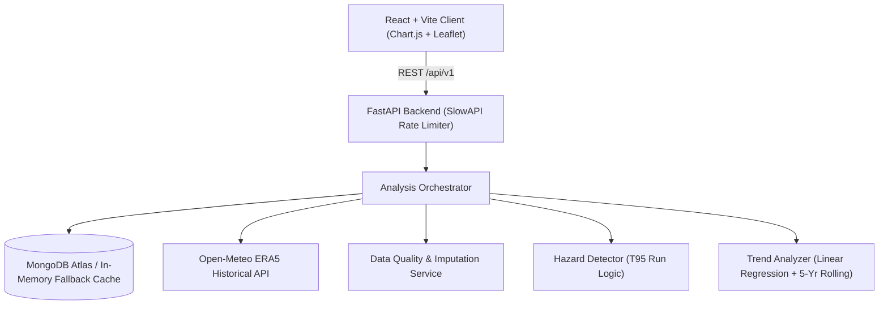

# Climate Hazard Trend Analyzer

Full-stack production-grade historical climate hazard analysis application built for the **Dygnify Ventures Pvt Ltd** Developer Case Study.

The application ingests historical ERA5 reanalysis weather data via Open-Meteo, cleans and audits data quality, detects heatwave hazard events using a fixed baseline 95th-percentile threshold, calculates annual frequency/duration trends via linear regression, and renders an interactive dashboard.

---

## 🚀 Live Demo & Repository
- **Frontend Dashboard:** [Deployed URL on Vercel/Netlify]
- **Backend API Docs:** [Deployed URL on Render/AWS] (`/docs` OpenAPI interactive documentation)
- **GitHub Repository:** Publicly accessible on GitHub

---

## 🏛️ System Architecture



### Tech Stack
| Component | Technology | Rationale & Purpose |
|---|---|---|
| **Frontend** | React 18, Vite | Fast, reactive SPA with glassmorphism UI design |
| **Visualizations** | Chart.js, react-chartjs-2, Leaflet | Annual frequency bars, rolling average curves & spatial maps |
| **Backend** | Python 3.12, FastAPI | High-concurrency async REST API with Pydantic v2 schemas |
| **Data Processing**| Pandas, NumPy, SciPy | Rigorous numeric transformations, leap-year calendars, regression |
| **Database** | MongoDB Atlas (Motor/PyMongo) | Canonical daily weather storage & TTL hash-cached analyses |
| **Rate Limiter** | SlowAPI | Protects external upstream APIs against brute-force calls |
| **Testing** | Pytest, pytest-asyncio | Complete automated unit, acceptance, and E2E test suite |

---

## 🧪 Climate & Hazard Logic (PRD Compliance)

### 1. Baseline Period & Threshold Calculation
- **Baseline Period:** `1991–2020` (30-year standard climatological normal).
- **Threshold ($T_{95}$):** Regional pooled 95th percentile of daily maximum temperatures (`temperature_2m_max`) during the 1991–2020 baseline using valid original observations.
- **Fixed Reference:** The threshold is computed once per region and held constant across all analysis years.

### 2. Operational Heatwave Definition
- An event is confirmed if and only if:
  $$T_{\max}(d) > T_{95}$$
  for **at least 3 consecutive calendar days**, with **valid original observations on every single day**.
- Runs of 4 or more consecutive days extend the same continuous event.
- A missing calendar date or temperature breaks the confirmed sequence.

### 3. Data Quality & Missing-Value Imputation Policy
- **Expected Calendar:** Full calendar generated per requested timeframe; absent dates explicitly flagged.
- **Mode-First with Median Fallback:** For missing days, valid original observations within a $[-5, +5]$ calendar-day window are examined. If a unique mode exists, it is imputed; otherwise, the median is applied.
- **Strict Safety Rule:** Imputed values are preserved for secondary display and **never qualify a day for confirmed heatwave detection or bridge missing days**.
- **Year Boundary Attribution:** An event crossing December 31 is recorded as one continuous event in the catalog; event count is attributed to start year, while qualifying days are allocated to their respective calendar years.

### 4. Data Coverage & Trend Eligibility
- **Annual Coverage:**
  $$\text{Coverage (\%)} = \frac{\text{Valid Original Daily Observations}}{\text{Expected Calendar Days (365 or 366)}} \times 100$$
- Years with **$<95\%$ coverage** are flagged and excluded from the primary linear regression slope.

---

## 📦 Local Installation & Setup

### Prerequisites
- Python 3.10+
- Node.js 18+ and npm
- (Optional) Local MongoDB or MongoDB Atlas URI (falls back gracefully to in-memory caching if omitted)

### 1. Backend Setup
```bash
cd backend
python -m venv venv
# Windows:
venv\Scripts\activate
# Linux/Mac:
source venv/bin/activate

pip install -r requirements.txt
cp .env.example .env

# Run unit and integration tests
pytest -v

# Start FastAPI server
uvicorn app.main:app --host 0.0.0.0 --port 8000 --reload
```
API Documentation will be available at `http://localhost:8000/docs`.

### 2. Frontend Setup
```bash
cd frontend
npm install
npm run dev
```
Open `http://localhost:5173` in your browser.

---

## 🛡️ API Endpoints Summary

| Method | Endpoint | Description |
|---|---|---|
| `GET` | `/api/v1/health` | Service health status, database connectivity & version |
| `GET` | `/api/v1/regions/presets` | Preset cities (Delhi, Mumbai, London, etc.) and state centroids |
| `POST` | `/api/v1/regions/resolve` | Validates custom coordinates / bounding boxes & returns region ID |
| `POST` | `/api/v1/analysis` | Executes or fetches cached heatwave analysis |
| `GET` | `/api/v1/analysis/{analysis_id}` | Retrieves completed analysis from cache by ID |
| `GET` | `/api/v1/regions/{region_id}/coverage`| Retrieves data coverage breakdown for a region |

---

## 🔍 Assumptions & Limitations

1. **ERA5 Reanalysis Nature:** ERA5 grid points represent atmospheric model reanalyses (~31km grid cells) rather than direct airport weather station measurements.
2. **Spatial Representation:** City queries sample the nearest ERA5 grid cell; state queries use documented geographic centroids; custom bounding boxes sample the centroid of bounded coordinates.
3. **Attribution Boundary:** Historical linear regression slopes describe trend directions within the selected baseline and do not prove causal attribution to climate change.
4. **Missing Days:** While imputation provides secondary continuity estimates, missing weather days can theoretically obscure brief extreme events.

---

## 🤖 AI Tool Usage Disclosure
This application was developed with the assistance of **Google DeepMind Antigravity AI**:
- Assisting with boilerplate scaffolding and Pydantic validation schemas.
- Accelerating Pytest test coverage across edge-case scenarios (cross-year events, missing day interruptions, zero baseline divisors).
- Developing modern responsive styling and glassmorphic UI components.
All calculations, hazard rules, and logic implementations were strictly verified against the Dygnify PRD requirements.
